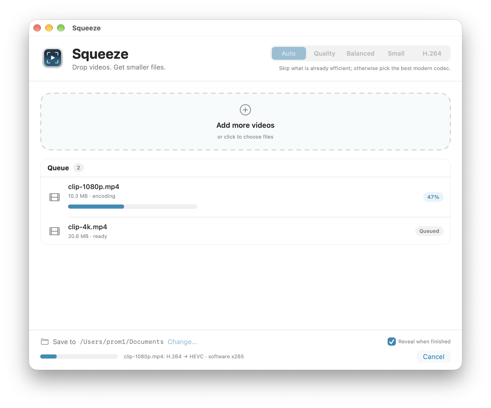
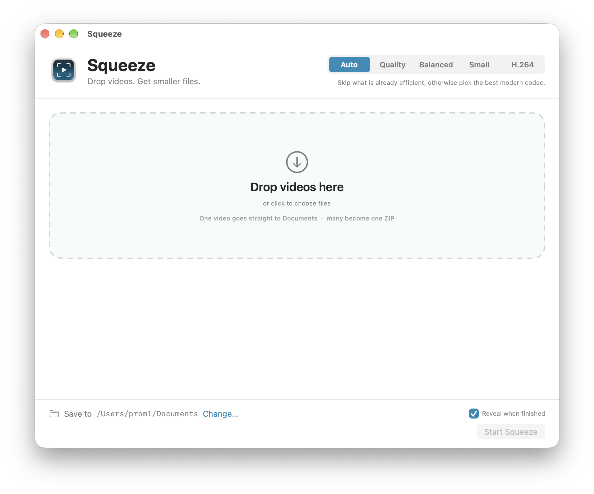
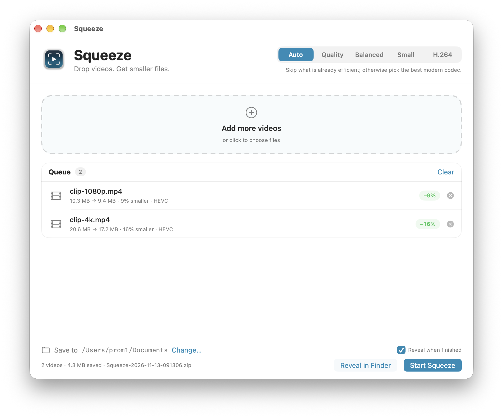

# Squeeze

A native macOS video compressor that stays out of the way.

Drop one video and it writes a smaller copy straight to `~/Documents`. Drop several and it produces one ZIP. Every video in the queue gets its own status and progress bar, so a batch never feels like a black box.



## Why Squeeze

- **Per-video status.** Each row moves through `Queued` → `Encoding` → `Done`, `Optimal`, or `Failed`, with its own progress bar and percentage.
- **No surprise bloat.** If an encode would be larger than the source, Squeeze retries stronger, then leaves the original alone.
- **One file or a whole batch.** A single video is written directly to the chosen folder. Multiple videos become one ZIP.
- **Native macOS everywhere.** Open With, Dock drops, a Finder service, notifications, Reveal in Finder, and a CLI.
- **Local only.** No uploads, no accounts, no telemetry. FFmpeg runs on your Mac.

## Screenshots

| Empty | Running | Finished |
| --- | --- | --- |
|  |  |  |

## Presets

| Preset | Codec | Behaviour |
| --- | --- | --- |
| Auto | HEVC / H.264 / AV1 | Skips what is already efficient, remuxes HEVC without re-encoding, otherwise chooses a modern codec. |
| Quality | HEVC | Largest, highest-fidelity output. Software x265 with a slower preset. |
| Balanced | HEVC | The everyday sweet spot: real savings without obvious quality loss. |
| Small | HEVC | Smallest files. Some fine detail is traded away. |
| H.264 | H.264 | MPEG-4 AVC for the widest playback support. |

Auto is intentionally conservative: it does not re-encode an already-efficient HEVC, AV1, or H.264 MP4 just to change the bytes. The H.264 preset also skips sources that are already efficient H.264.

## Per-video status

The queue is the source of truth. Each row owns its state:

| State | What the row shows |
| --- | --- |
| `Queued` | Source size and `ready` |
| `Encoding` | Live progress bar, percentage badge, and current codec/encoder |
| `Done` | Source → output size, percent smaller, and output codec |
| `Optimal` | The source is already efficient; nothing was written |
| `Failed` | A readable error for that specific file |

The footer shows the overall batch progress and the current filename. A failure in one file does not stop the rest of the batch.

## Requirements

- macOS 13 or newer (built and tested on macOS 27.2, Apple silicon).
- FFmpeg and FFprobe on `PATH`. Homebrew install:

```sh
brew install ffmpeg
```

- To build: Xcode Command Line Tools (`xcrun`, `swiftc`). Full Xcode is not required.

## Install

```sh
git clone git@github-main:zaidanali028/Squeeze.git
cd Squeeze
./build.sh
./install.sh
```

`install.sh` builds the app, copies it to `~/Applications`, links the CLI at `~/.local/bin/squeeze`, and registers the bundle with Launch Services. The app is ad-hoc signed, not notarized, so it is intended for local use.

If `~/.local/bin` is not on your `PATH`, add it to your shell profile:

```sh
export PATH="$HOME/.local/bin:$PATH"
```

## Use the app

1. Drop videos or a folder onto the window, use **Open With**, or drag onto the Dock icon.
2. Pick a preset.
3. Press **Start Squeeze**.

You can also right-click files in Finder and choose **Services → Squeeze Video** after the app has been launched once.

Settings:

- **Save to** changes the output folder. The default is `~/Documents`.
- **Reveal when finished** opens the output in Finder when the batch completes.

## Command line

The app bundle ships `squeeze`:

```sh
squeeze [options] <file-or-folder> [more...]
```

| Option | Description |
| --- | --- |
| `-p, --preset <auto\|quality\|balanced\|small\|compatible>` | Compression preset. `compatible` is the H.264 preset. |
| `-o, --out <dir>` | Output folder. Defaults to `~/Documents`. |
| `--keep-folder` | For batches, keep the encoded folder next to the ZIP. |
| `--reveal` | Show the result in Finder. |
| `--json` | Machine-readable result output. |
| `-h, --help` | Show help. |
| `-v, --version` | Show the version. |

Examples:

```sh
squeeze ~/Movies/clip.mov
squeeze -p balanced ~/Movies/*.mp4 --reveal
squeeze -p compatible ~/Desktop/footage
squeeze -p small --json input.mov
```

The CLI prints one status line per file and exits non-zero if any file fails. Use `--json` for automation.

## Outputs

- Single video: `<output-dir>/<name>-hevc.mp4` or `<output-dir>/<name>-h264.mp4`.
- Batch: `<output-dir>/Squeeze-YYYY-MM-DD-HHMMSS.zip`, containing the encoded files at the ZIP root.
- Name collisions get `-2`, `-3`, and so on.
- Existing stems ending in `-optimized`, `-compressed`, `-h264`, or `-hevc` are cleaned before adding the new suffix.
- Sources are never modified or deleted.

Audio is stream-copied when the codec is MP4-compatible (`aac`, `alac`, `ac3`, `eac3`, `mp3`). Otherwise it is encoded to AAC at 192 kbps stereo or 384 kbps for more than two channels. Only the first video track, all audio tracks, chapters, and global metadata are mapped. Subtitle and data tracks are not carried over.

## How Auto decides

1. AV1 → HEVC, for smoother native macOS playback.
2. Efficient HEVC/AV1 MP4s (≤ 0.10 bits per pixel) are skipped.
3. HEVC outside MP4 with MP4-compatible audio is remuxed to MP4 without quality loss.
4. Efficient H.264 MP4s (≤ 0.08 bits per pixel) are skipped.
5. Everything else is encoded: hardware HEVC for very large frames, otherwise software x265.

“Very large” means more than 900 million pixels per second or a height above 2160. This keeps 8K and high-frame-rate sources practical while using x265 for the quality-sensitive cases.

## No-bloat guarantee

After every encode Squeeze checks the output size against the source. If the output is not smaller:

1. It deletes the output and retries with a stronger setting (`CRF + 4` for software, `q − 8` for VideoToolbox).
2. If the retry is still not smaller, it deletes the output and marks the row **Optimal** with an explanation.

The source file is always left untouched.

## Privacy and local data

- No network requests, analytics, or accounts.
- Encoding happens entirely on the Mac through FFmpeg.
- Logs: `~/Library/Logs/Squeeze/squeeze.log` and per-encode logs in the same folder.
- Batch scratch space: `~/Library/Caches/Squeeze/`. Temporary folders are removed after the ZIP is created unless `--keep-folder` is used.

## Limitations

- H.264 output is 8-bit. The HEVC path preserves 10-bit sources and color tags.
- HDR static mastering metadata (MaxCLL/MaxFALL, mastering display metadata) is not fully preserved.
- 8K H.264 is slow by design because `h264_videotoolbox` does not support 8K; Squeeze falls back to software x264.
- Subtitles and data tracks are dropped; the first video track and all audio tracks are kept.
- The app is ad-hoc signed, not notarized. macOS may ask for confirmation the first time it opens.
- Visual quality is measured by size and codec settings, not by a per-file VMAF pass.

## Troubleshooting

| Problem | Fix |
| --- | --- |
| `ffmpeg was not found` | Install FFmpeg: `brew install ffmpeg`, then relaunch the app so it picks up `PATH`. |
| The app does not appear in Open With | Launch it once, then run `./install.sh` again to re-register the bundle. |
| Everything is marked Optimal | The sources are already efficient for the selected preset; try Quality or H.264. |
| H.264 8K takes a long time | Expected. VideoToolbox H.264 does not support 8K, so software x264 is used. |
| A batch failed halfway | Check the row error and `~/Library/Logs/Squeeze/`. Successful files are kept. |
| Finder service is missing | Launch Squeeze once, then check **Services** settings in Keyboard settings. |

## Project layout

```text
Squeeze/
├── Sources/
│   ├── Models.swift       presets, media info, plans, outcomes
│   ├── Engine.swift       probe, plan, encode, remux, verify, ZIP
│   ├── JobModel.swift     queue, per-video state, notifications
│   ├── ContentView.swift  SwiftUI window, drop zone, queue rows
│   ├── SqueezeApp.swift   app lifecycle, Open With, Finder service
│   └── CLI.swift          squeeze command-line interface
├── Resources/
│   ├── Info.plist         bundle metadata, document types, service
│   ├── AppIcon.icns
│   └── icon-1024.png
├── Tools/
│   ├── make_icon.py       icon generator
│   └── render_ui.swift    offscreen UI snapshots
├── docs/
│   ├── ARCHITECTURE.md
│   ├── TESTING.md
│   └── images/
├── build.sh
├── install.sh
└── README.md
```

## Build and verify

```sh
./build.sh
./install.sh
squeeze --help
```

The build produces:

```text
build/Squeeze.app
build/Squeeze.app/Contents/MacOS/Squeeze
build/Squeeze.app/Contents/MacOS/squeeze-cli
```

`build.sh` compiles the SwiftUI app and the CLI separately, copies the resources, and ad-hoc signs the bundle. No Xcode project is required.

## Documentation

- [Architecture](docs/ARCHITECTURE.md) — how probing, planning, encoding, size guarding, and ZIP creation fit together.
- [Testing](docs/TESTING.md) — the test matrix and observed results.
- [Changelog](CHANGELOG.md) — release notes.

## Status

Version 1.0.0. Private project, maintained for personal use.
